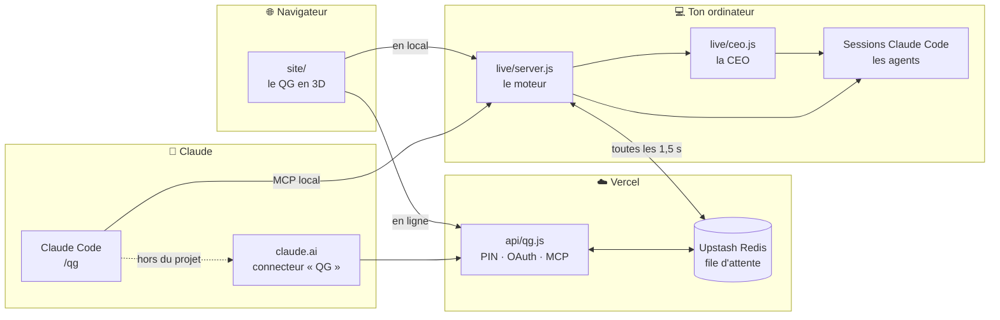

# JILL KORP · le QG

Le quartier général de mes agents IA, en 3D dans le navigateur. Une île flotte dans le ciel, avec un bureau sans toit pour voir dans chaque pièce, une salle par pôle et chaque agent à son poste. Les agents sont de vraies sessions [Claude Code](https://claude.com/claude-code) : on peut discuter avec eux, leur confier des tâches, ou passer par la CEO qui répartit le travail dans l'équipe.

- **En local** : `node live/server.js`, puis <http://127.0.0.1:8787>.
- **En ligne** : <https://jill-korp-qg.vercel.app>. La visite est libre, le reste est protégé par un PIN. Ton ordinateur fait toujours le travail.

## Sommaire

- [Démarrer](#démarrer)
- [Visiter le QG](#visiter-le-qg)
- [Les agents au travail](#les-agents-au-travail)
- [La CEO et la commande /qg](#la-ceo-et-la-commande-qg)
- [Le QG en ligne](#le-qg-en-ligne)
- [Sécurité](#sécurité)
- [Organisation du code](#organisation-du-code)
- [Feuille de route](#feuille-de-route)
- [Crédits](#crédits)

## Démarrer

Il faut [Node.js](https://nodejs.org). Il n'y a aucune dépendance à installer.

```powershell
node live/server.js
```

Ouvre ensuite <http://127.0.0.1:8787>. Pour changer de port : `$env:PORT=9000; node live/server.js`.

Pour que les agents répondent, Claude Code doit être installé et connecté sur l'ordinateur (commande `claude`). Après une modification de `live/server.js`, arrête le serveur (Ctrl+C) puis relance-le.

## Visiter le QG

### Se déplacer

- **Vue d'ensemble** : la caméra tourne lentement autour de l'île.
  - Clic gauche : pivoter. Molette ou pincement : zoomer.
  - Clic droit, ZQSD ou flèches : se déplacer.
  - Échap : revenir à la vue d'ensemble.
- **Pôles** : un clic sur une salle, ou sur un pôle dans le panneau, fait voler la caméra jusqu'à elle et ouvre la fiche de la salle.
- **Visite à la première personne** : bouton « J'entre », ou double-clic sur une salle.
  - ZQSD ou flèches pour marcher, Maj pour courir, la souris pour regarder.
  - E pour ouvrir une porte, lever la barrière du pont ou parler à un agent.
  - Murs et meubles ne se traversent pas.
  - Une minimap, en haut à droite, montre le plan autour de soi, les agents et le nom de la salle.

### Les onglets du bas

- **Pôles** : parcourt un par un les sept pôles, le Quartier Général et chaque lieu commun.
- **Équipe** : ce que fait chaque agent en ce moment, regroupé par pôle. Pour une tâche, on voit depuis quand elle tourne, le début de la consigne et la dernière action ; pour les autres agents, leur situation habituelle.
  - On peut aussi y cocher des agents pour lancer une **réunion** : ils marchent jusqu'à la salle de réunion par les couloirs, s'y installent, puis rentrent à leur bureau.
- **Outils** : tes connecteurs, regroupés (claude.ai, extensions, cet ordinateur), avec leur état. Une pastille rouge signale un connecteur en panne.

En haut de l'écran, un **bandeau** montre les logos des connecteurs qui marchent. Quand un agent se sert d'un connecteur, son logo s'allume avec le prénom de l'agent.

### Un QG vivant

- Des promeneurs vont et viennent entre le café, l'arcade, la terrasse et le Hall. Ils discutent quand ils se croisent, avec des bulles au-dessus de la tête.
- Un agent en pause va de temps en temps au café ou à l'arcade.
- Quelques détails un peu fous :
  - quelqu'un travaille sur un tapis de course ;
  - un drone livre des cafés ;
  - un robot aspirateur fait le ménage dans le Hall.
- Huit planètes tournent autour de l'île. La Lune affiche sa phase réelle du jour.

### Graphismes

- Ombres douces, matériaux physiques, et vitres qui reflètent une ambiance de ciel.
- Le panneau propose « Graphismes : élevés / légers ». Le choix est gardé dans le navigateur.
- Si l'ordinateur peine trop, le QG passe tout seul en graphismes légers.
- L'interface reprend le style sci-fi de Kenney : titres en Kenney Future, texte en Inter. Les fenêtres prennent la couleur de leur pôle.

## Les agents au travail

Un clic sur un agent ouvre sa **fiche** :
- qui il est : portrait 3D, poste, pôle, lieu de travail ;
- ce qu'il fait en ce moment ;
- son rôle au QG : missions, outils et collègues.

L'équipe compte 23 agents répartis en 8 pôles, tous décrits dans `EQUIPE.md`.

En bas de la fiche, deux boutons :

- **Discuter** : l'agent répond avec sa personnalité, sans aucun outil. Rien n'est enregistré.
- **Confier une tâche** : une vraie session Claude Code travaille dans `live/travaux/<Prénom>/`, avec la lecture, l'écriture et la recherche web.
  - Pendant ce temps, l'agent tape à son bureau, et la fenêtre montre chaque outil utilisé et chaque fichier touché.
  - À la fin : son compte rendu, les fichiers créés et le coût de la tâche.
  - 4 tâches au plus en même temps.

**Modèles et plafonds** (`live/modeles.js`)

| Modèle | Plafond par tâche | Agents |
| --- | --- | --- |
| Opus 5.5 | 4 $ | Jillian, Théo, Max, Zoé, Ada, Iris |
| Sonnet 5.5 | 2 $ | tous les autres |
| Haiku 5.5 | 1 $ | Hugo, Nour, Milo, Joss |

Les discussions passent toutes par Haiku 5.5.

**Connecteurs** (`live/connecteurs.js`)

- Certains agents utilisent tes connecteurs claude.ai pendant leurs tâches : Gmail, Google Agenda, Notion, Google Drive, Gamma, Figma, Vercel, Cloudflare.
- Chacun n'a que les outils précis prévus pour son poste : tous les autres lui sont cachés, et un garde-fou arrête la session au moindre appel interdit.
- Aucun mail n'est jamais envoyé.

**Corbeille Gmail sur ton accord**

- Quand Léa trie la boîte, elle ne supprime rien : elle propose une liste.
- Seuls les mails que tu coches partent à la corbeille (récupérables 30 jours).
- Cette mise à la corbeille passe par une seconde session qui n'a que cet outil.

## La CEO et la commande /qg

Jillian, la CEO, est au-dessus de toute l'équipe. Elle connaît chaque agent : poste, missions, outils, modèle. Quand tu lui confies une demande :

1. elle la découpe en missions et attribue chacune au bon agent ;
2. elle enchaîne des étapes quand une mission dépend d'une autre (par exemple, Max code puis Théo relit) ;
3. le serveur lance les tâches dès qu'une place se libère, et tu les vois travailler dans le QG ;
4. elle rédige un compte rendu final, rangé dans `live/travaux/Jillian/missions/`.

**Depuis Claude Code** : démarre le QG, ouvre une session `claude` dans le dossier du projet, puis tape :

```text
/qg prépare la page d'accueil du nouveau site
```

`/qg` sans demande donne l'état du QG. La première fois, Claude Code demande d'approuver le serveur MCP « qg » du projet (`.mcp.json`).

- Le MCP local (`live/mcp-qg.js`) joint le serveur grâce à `live/.qg-session.json` (non versionné).
- Hors du dossier du projet, `/qg` passe par le connecteur en ligne « QG » (voir plus bas).
- Pour avoir `/qg` partout, copie `.claude/commands/qg.md` dans `~/.claude/commands/`.

Outils du MCP : `demander_au_ceo`, `suivre_mission`, `etat_du_qg`.

La planification et le compte rendu coûtent chacun au plus 0,50 $, en plus des tâches des agents. Un agent ne peut jamais rappeler la CEO.

## Le QG en ligne

Le site est publié sur Vercel, avec un connecteur pour Claude. **Ton ordinateur reste le moteur** : le site en ligne n'exécute rien et ne voit jamais tes fichiers.

```text
 navigateur / Claude ──► Vercel (site + api/qg.js) ──► file d'attente Upstash Redis
                                                              ▲        │
                                                   réponses   │        ▼  toutes les 1,5 s
                                                       ton ordinateur : node live/server.js
```

Si ton ordinateur est éteint, le site le dit et rien ne démarre.

### Qui peut quoi

| Action | Ce qu'il faut |
| --- | --- |
| Visiter le QG, voir qui travaille (sans le contenu) | rien |
| Discuter, lire les tâches et les comptes rendus, voir les connecteurs | le PIN, une fois (session de 12 h dans l'onglet) |
| Confier une tâche, mettre des mails à la corbeille | le PIN, **à chaque fois** |
| Confier une demande à la CEO depuis Claude | le connecteur relié (PIN entré une seule fois, au moment de le relier) |

### Mise en service (une seule fois)

1. Dans le projet Vercel : Storage → ajouter **Upstash Redis** et le relier au projet.
2. Sur ton ordinateur, lance :
   ```powershell
   node live/configurer-en-ligne.js
   ```
   Le script te demande :
   - l'adresse du site ;
   - `KV_REST_API_URL` et `KV_REST_API_TOKEN` (Vercel → Storage → ta base → « .env.local ») ;
   - ton PIN, deux fois.

   Il écrit `live/.qg-en-ligne.json` (non versionné) et range l'empreinte du PIN dans Redis.
3. Redémarre le QG local. La console doit afficher « QG en ligne : relié ».
4. Dans claude.ai, va dans Réglages → Connecteurs → « Ajouter un connecteur personnalisé » :
   - nom **QG** (`/qg` cherche ce nom) ;
   - adresse `https://jill-korp-qg.vercel.app/api/mcp`.

   Claude ouvre alors la page du QG : entre ton PIN pour l'autoriser.

Dans une conversation claude.ai, il n'y a pas de commande « / » : demande simplement à Claude de confier ta demande au QG.

Pour changer de PIN, relance `node live/configurer-en-ligne.js` et appuie sur Entrée pour garder l'adresse et le jeton.

## Sécurité

**En local**
- Le serveur n'écoute que sur `127.0.0.1`.
- Il refuse toute demande qui ne vient pas de la page du QG : adresse, origine et jeton secret recréé à chaque démarrage.
- Les travaux des agents restent sur l'ordinateur (`live/travaux/` n'est pas versionné).

**Connecteurs**
- La page ne reçoit que le nom et l'état de chaque connecteur : jamais une adresse, une commande ou un message d'erreur.

**En ligne**
- **PIN** : il n'est écrit nulle part ; seule son empreinte (scrypt avec un sel) est stockée.
  - 5 erreurs bloquent une adresse pendant 15 minutes.
  - 30 erreurs en une heure suspendent toute vérification pendant une heure.
- **Jetons** : les jetons de session et OAuth sont aléatoires et rangés sous leur empreinte.
- **Connexion OAuth** :
  - un code d'autorisation ne sert qu'une fois ;
  - PKCE est obligatoire, et chaque jeton de renouvellement est remplacé par un nouveau à chaque usage ;
  - seuls claude.ai, claude.com et un poste local peuvent se relier.

**Dépôt**
- Le dépôt est public : aucune clé, aucun mot de passe ni aucune adresse e-mail dans le code.

## Organisation du code

### Vue d'ensemble



### Les dossiers

```text
my_agency/
│
├── 🏝️ site/ ─────────────────── le QG, servi tel quel (en local et sur Vercel)
│   ├── index.html                  page principale
│   ├── mentions.html               crédits des modèles et des bibliothèques
│   ├── css/qg.css                  styles de l'interface
│   ├── js/
│   │   ├── 🧱 le monde
│   │   │   ├── main.js             caméra, interactions, boucle d'affichage
│   │   │   ├── donnees.js          pôles, salles et agents (repris de EQUIPE.md)
│   │   │   ├── monde.js            l'île, le bâtiment, les salles
│   │   │   ├── mobilier.js         meubles, personnages, mascottes
│   │   │   ├── details.js          tasses, livres, lampes, enseignes
│   │   │   ├── modeles.js          chargement des modèles Kenney
│   │   │   ├── outils.js           matériaux, formes, textures communes
│   │   │   ├── graphismes.js       qualité élevée ou légère
│   │   │   └── planetes.js         planètes en orbite, Lune à sa vraie phase
│   │   ├── 🚶 la vie du QG
│   │   │   ├── visite.js           visite à la première personne
│   │   │   ├── collisions.js       murs et meubles qu'on ne traverse pas
│   │   │   ├── minimap.js          plan affiché pendant la visite
│   │   │   ├── chemins.js          grille du sol et algorithme A*
│   │   │   ├── marche.js           pas, bras qui balancent, portes qui s'ouvrent
│   │   │   ├── reunion.js          réunions et pauses des agents
│   │   │   ├── foule.js            promeneurs et figurants
│   │   │   └── fous.js             tapis de course, drone, robot aspirateur
│   │   └── 🪟 l'interface
│   │       ├── etiquettes.js       étiquettes des salles et des agents
│   │       ├── onglets.js          onglets Pôles, Équipe, Outils
│   │       ├── bandeau.js          logos des connecteurs
│   │       ├── fenetre-agent.js    fiche d'un agent : discuter, confier une tâche
│   │       ├── portrait.js         portrait 3D de la fiche
│   │       ├── api.js              liaison avec le serveur (local ou en ligne)
│   │       └── pin.js              fenêtre du code PIN
│   ├── ui/                         interface Kenney, logos, polices
│   ├── models/kenney/              modèles 3D
│   └── vendor/three/               three.js r160
│
├── ⚙️ live/ ─────────────────── le moteur, sur ton ordinateur
│   ├── server.js                   serveur local sans dépendance : site + API des agents
│   ├── modeles.js                  modèle et plafond de chaque agent
│   ├── connecteurs.js              outils autorisés par agent, garde-fou, corbeille
│   ├── outils-mcp.js               état des connecteurs (claude mcp list)
│   ├── ceo.js                      la CEO : planification, étapes, compte rendu
│   ├── mcp-qg.js                   MCP local pour Claude Code
│   ├── en-ligne.js                 liaison avec le QG en ligne
│   ├── configurer-en-ligne.js      configuration du QG en ligne (stockage, PIN)
│   └── travaux/                    dossiers de travail des agents (non versionnés)
│
├── ☁️ api/ ──────────────────── le QG en ligne (une fonction Vercel)
│   ├── qg.js                       routes : PIN, sessions, OAuth, MCP, file d'attente
│   └── _lib/
│       ├── redis.js                accès à Upstash Redis
│       ├── securite.js             PIN, sessions, limite d'essais
│       ├── oauth.js                liaison du connecteur Claude
│       ├── mcp.js                  outils du connecteur
│       └── file.js                 file d'attente vers ton ordinateur
│
├── 🧩 configuration
│   ├── vercel.json                 publication de site/, réécritures vers api/qg.js
│   ├── .mcp.json                   déclaration du MCP local
│   └── .claude/commands/qg.md      la commande /qg
│
└── 📄 documents
    ├── BRIEF.md                    le cahier des charges
    ├── EQUIPE.md                   pôles, agents, lieux, mascottes
    └── maquettes/                  les 7 maquettes successives (la 7 a été validée)
```

> Les sous-titres en émoji (🧱, 🚶, 🪟, 🧩, 📄) regroupent les fichiers par rôle : ce ne sont pas de vrais dossiers.

## Feuille de route

1. ~~Maquettes à valider~~
2. ~~L'île en 3D, caméra qui tourne, clic sur un pôle pour y voler~~
3. ~~Étiquette au-dessus de chaque agent : prénom, poste, état~~
4. ~~Bouton « J'entre » : marcher à la première personne et ouvrir les portes~~
5. ~~Parler à un agent et lui confier une tâche qui lance une vraie session Claude Code~~
6. ~~Brancher certains agents sur mes outils (connecteurs)~~
7. ~~La CEO qui distribue le travail, et la commande `/qg`~~
8. ~~Le QG en ligne, protégé par un PIN, avec un connecteur pour Claude~~

## Crédits

- **Modèles 3D, images et interface** : [Kenney](https://kenney.nl), licence CC0. Packs utilisés : *Furniture Kit*, *Nature Kit*, *Mini Arcade*, *Planets*, *UI Pack: Sci-fi* (avec les polices Kenney Future) et *Minimap Pack*.
- **Logos** : [Simple Icons](https://simpleicons.org) (CC0) pour les marques présentes ; les autres ont été dessinés pour le QG (`site/ui/logos`).
- **Bibliothèque 3D** : [three.js](https://threejs.org), licence MIT.
- **Police du texte** : [Inter](https://rsms.me/inter/), SIL Open Font License 1.1.

Le détail est dans la page **Mentions** du QG.
